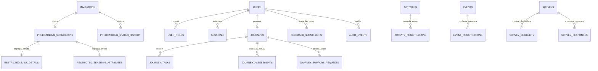

# Arquitetura, Governança, Privacidade e Validação — Enap e-Vida

> **Nota de transparência:** Este protótipo navegável e funcional utiliza exclusivamente **dados fictícios** em ambiente demonstrativo. Ele implementa controles técnicos reais de segurança, privacidade, acessibilidade e segregação de funções, mas **não declara conformidade legal definitiva** com a LGPD, WCAG 2.2 ou OWASP ASVS sem auditoria formal e validações institucionais prévias à entrada em produção.

---

## 1. Arquitetura da Solução

- **Frontend:** React 19 + TypeScript + Tailwind CSS v4 + React Router v7 + Recharts + PWA (`vite-plugin-pwa` com estratégia `NetworkOnly` para `/api/*`). Tipografia institucional **Georama** auto-hospedada via `@fontsource/georama` e paleta extraída do **RGI 2025**.
- **Backend:** Node.js + Express (`server.ts` + `/server/*`) com middleware de autenticação por sessão HTTP-only assinada (`evida_sid`), RBAC validado no servidor em todas as rotas administrativas e sensíveis, transações atômicas para controle de vagas/lista de espera e trilha de auditoria.
- **Persistência:**
  - **Piloto:** PostgreSQL local ou Neon, configurado por `DATABASE_URL`, com cifragem de campo **AES-256-GCM** para tabelas segregadas (`restricted_bank_details` e `restricted_sensitive_attributes`) e hashing de senhas com `scrypt` + salt aleatório.
  - **Referência de produção (PostgreSQL 16+):** DDL completa em `/docs/database/migrations/001_initial_schema.sql` com 8 schemas lógicos e políticas de **Row-Level Security (RLS)** nos compartimentos restritos.

---

## 2. Diagrama Entidade-Relacionamento (ERD — Visão de Domínios)

---

## 3. Matriz RBAC e Segregação de Funções (11 Papéis)

| Papel (`role_code`) | Escopo Principal | Acesso ao Cofre Bancário/Sensível (`preboarding:view_restricted_vault`) |
|---|---|---|
| `pre_ingressante` | Acompanhamento Pré-Embarque | Não |
| `usuario_regular` | Comunidade Enap (`/app/*`) | Não |
| `chefia` | Comunidade + tarefas de acolhimento como chefia imediata | Não |
| `resp_pre_ingresso` | Gestão do fluxo "A caminho da Enap?" e conferência | **Sim (exclusivo e auditado)** |
| `gestor_ambientacao` | Orquestração da Jornada, modelos, apoios e melhoria contínua | Não |
| `gestor_pqvt` | Catálogo PQVT, vagas, presenças e eventos | Não |
| `gestor_conteudo` | Repositório, eventos e Fala, Enap! | Não |
| `gestor_comite_dei` | Projetos, campanhas e agenda do Comitê DEI | Não |
| `gestor_enquetes` | Construtor de enquetes e apuração agregada | Não |
| `analista_indicadores` | Painel de indicadores estratégicos (Produtos/Resultados/Impacto) e exportação CSV | Não |
| `admin_tecnico` | Usuários, perfis, parâmetros GAEG, auditoria (sem cofre bancário) | **Não (segregação de funções)** |

---

## 4. Inventário Preliminar de Tratamento de Dados (LGPD — Lei nº 13.709/2018)

| Fluxo | Dados Tratados | Minimização e Proteção Aplicada | Pendência de Validação Institucional |
|---|---|---|---|
| Cadastro regular ("Novo por aqui?") | Nome, nome social, e-mail, vínculo, unidade, cargo, data de entrada | Sem CPF, RG ou dados bancários; sem autodeclaração de perfil admin | Enquadramento formal da base legal junto à DPO/PF-Enap |
| Pré-Embarque GAEG NS/NI | Identificação civil, histórico 10 anos, vínculo, chefia imediata, dados bancários, autodeclaração | Convite institucional obrigatório; cifragem AES-256-GCM em compartimentos segregados; comprovante e notificações mascarados | Revisão jurídica do termo de ciência, tabela de temporalidade e RIPD |
| PQVT | Inscrições, lista de espera, avaliações qualitativas | Proibição de dados clínicos, diagnósticos, biométricos e rankings | Política de retenção de listas de presença |
| Enquetes Anônimas | Elegibilidade (`survey_eligibility`) vs. Respostas (`survey_responses` com `user_id = NULL`) | Separação física de tabelas + supressão automática quando `n < 10` | Definição institucional de exceções de limiar para unidades muito pequenas |

---

## 5. Rigor Metodológico dos Indicadores (Semana de Inovação)

- Separação explícita entre **Produtos** (cobertura, preparação Dia 1, ocupação PQVT), **Resultados** (clareza de papel, apoio e vínculos, dificuldades) e **Impacto** (pertencimento contínuo — exigindo séries longitudinais e cautela causal).
- **Ausência de dados nunca é exibida como zero.** Indicadores sem amostra exibem `"Sem dados disponíveis"` e amostras com `n < 10` em métricas de percepção são suprimidas.
- Os percentuais históricos citados na apresentação da Semana de Inovação (**96%**, **70%** e **100%**) **não** são transportados como evidência atual comprovada neste painel; sua divulgação institucional depende da documentação prévia de amostra, período, instrumento, taxa de resposta e possíveis vieses.

---

## 6. Checklists Técnicos (Implementado vs. Pendente de Validação em Produção)

### Segurança (Referência OWASP ASVS)
- [x] Senhas com hash `scrypt` e salt aleatório por usuário (nunca texto simples).
- [x] Sessões via cookie `HttpOnly`, `SameSite=Lax`, sem tokens ou PII em `localStorage`/`sessionStorage`.
- [x] Proteção contra enumeração de contas no login e na recuperação de senha.
- [x] Autorização RBAC e verificação de propriedade (anti-IDOR/BOLA) aplicadas no servidor.
- [x] Rate limiting em rotas de autenticação e Pré-Embarque + cabeçalhos HTTP defensivos (`X-Content-Type-Options`, `Referrer-Policy`).
- [x] Service Worker PWA configurado como `NetworkOnly` para `/api/*`.
- [ ] Gestão de chaves criptográficas em KMS/HSM corporativo (Key Vault / Cloud KMS) na implantação oficial.
- [ ] Integração SSO com Microsoft Entra ID + MFA corporativo obrigatório + testes de intrusão (pentest) pré-produção.

### Acessibilidade (Referência WCAG 2.2 AA / eMAG)
- [x] Link “Pular para o conteúdo principal”, navegação por teclado e foco visível de alto contraste.
- [x] Contraste institucional validado (>= 4,5:1) na paleta inspirada no RGI 2025.
- [x] Preferências de fonte ampliada, alto contraste e redução de movimento em Meu Perfil.
- [x] Campo de recursos de acessibilidade obrigatório em atividades PQVT e eventos.
- [ ] Auditoria assistida com pessoas usuárias de leitores de tela (NVDA, JAWS, VoiceOver) antes do lançamento público.

---

## 7. Pendências de Validação Institucional Antes de Produção

1. **Valores e textos legais GAEG NS/NI:** confirmar junto à CGP/Enap se os valores de referência do documento anexo (R$ 4.544,26 / teto R$ 21.454,12 e R$ 2.908,64 / teto R$ 13.974,75) permanecem vigentes ou se devem ser atualizados via `/admin/parametros`.
2. **Comitê DEI:** confirmar denominação estatutária exata, composição nominal e ato normativo de instituição.
3. **Logomarca oficial:** substituir a representação vetorial demonstrativa pela versão oficial licenciada pela CGCOM/Enap.
4. **Integrações corporativas futuras:** provisionar contratos reais com Microsoft Entra ID, Teams, Outlook, SharePoint, Power BI e SEI junto à CGTI/Enap.
